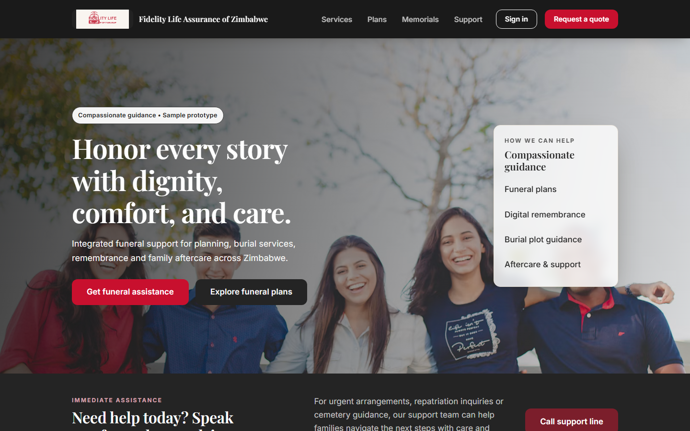

# Fidelity Funeral Services

A digital home for families in Zimbabwe and the diaspora when they lose someone. It brings funeral planning, cover, burial arrangements, remembrance and aftercare into one place, so a grieving family has one place to go instead of many phone calls.

> This is a sample prototype. All plans, prices, policies, people and memorials in it are made up.

## Who it is for

- **Families who need help now**: someone has just passed away and they need to know what to do next.
- **People planning ahead**: comparing funeral plans for themselves or their family.
- **Policyholders**: checking their cover and asking for help, such as making a claim.
- **Relatives and friends**: remembering a loved one and leaving a tribute, wherever they live.
- **Funeral professionals**: managing the services they deliver for families.

## What families can do

### Get help straight away

The first thing on the page is a way to reach a funeral care adviser. Urgent arrangements, transport, repatriation questions and cemetery guidance all start from here.

### Choose a funeral plan

Compare three plans (**Essential**, **Comfort** and **Legacy**), see what each one covers, and request a quote that fits the family's size and wishes.

### Find a burial place

Search cemeteries by town or area, compare plot guidance and send an enquiry about a grave.

### Bring someone home

Repatriation support for families abroad: an overview of the journey, transport and the documents needed to arrange a funeral across borders.

### Remember a loved one

Create an online memorial with their life story and photographs. Keep it private until it is ready, then publish and share the link. Visitors can leave flowers, light a candle and write a tribute, and the family reads every tribute before it is shown.

### Arrange everything else

A marketplace of trusted partners for what a funeral needs: headstones and plaques, wreaths, marquee and seating hire, programmes and stationery, and memorial video tributes.

### Stay supported afterwards

Aftercare does not stop at the funeral. Families get guidance on next steps, estate help and ideas for remembrance, including AI-assisted suggestions.

## Your account

Customers sign in with their mobile number and a one-time code, with no password to remember. From their account they can:

- **Link their policy** and see who is covered and for how much.
- **Ask for help**, for example "a loved one has passed away" or "make a claim", choose how they want to be contacted (phone call, WhatsApp or SMS) and follow the request from *received* to *complete*.
- **Manage memorials** they have created: story, photos, tributes and sharing.
- **Keep their profile** up to date.

## For funeral providers

A provider portal, for provider staff and administrators who sign in, shows how funeral professionals could manage the services they run for families.

## Trying the demo

Run `npm install` and then `npm run dev`, and open the address it prints.

- On the sign-in page, pick one of the **demo personas** (a policyholder, a new family or provider staff) to get in with one click.
- The one-time code is always `123456`.
- To link a policy by hand, use policy number `FLA-318227` with ID `08-765432-B-15`.
- Everything you do is saved in your own browser only.

How the app is built, and how to connect it to a real backend, is in [docs/development.md](docs/development.md).
